# Infrastructure as code

Run `terraform plan` on pull requests and `terraform apply` only from trusted runs. One mapping entry can grant both roles, each with its own conditions.

Worked config: [`examples/iac/config.yaml`](examples/iac/config.yaml). Per-role keys: [CONFIGURATION.md](CONFIGURATION.md#per-role-settings).

## Recommended privileged role

Combine three conditions on the apply role. All three must hold:

- `ref`: the branch the run executes on.
- `environment`: the GitHub deployment environment the job declares.
- `event_name`: an allow-list of trigger events.

Optionally pin `workflow_ref` to the workflow file.

```yaml
role_mappings:
  - subject: "octo-org/infra"
    roles:
      - role: "arn:aws:iam::111122223333:role/TerraformPlan"
        conditions:
          event_name: ["pull_request", "push"]
        session_policy_file: "session-policies/terraform-plan.json"
      - role: "arn:aws:iam::111122223333:role/TerraformApply"
        conditions:
          event_name: ["push", "workflow_dispatch"]
          ref: "refs/heads/main"
          environment: "production"
          workflow_ref: 'octo-org/infra/\.github/workflows/apply\.yml@refs/heads/main'
        role_session_name: "terraform-apply"
```

Conditions at one level are AND'd. A role's `conditions` replace the entry's; they never intersect with them.

How the worked config answers common runs:



## Variants

[`examples/iac/config.yaml`](examples/iac/config.yaml) lists three variants:

1. **All AND** (above). Use it by default.
2. **Weaker `any_of`**: `ref` or `environment`, for teams that deploy from several branches. A run that declares only the environment is trusted as far as that environment's protection rules go.
3. **Two entries**: one entry per role, each with entry-level conditions. Use it when the roles differ in subject or issuer, or when you prefer the flat shape.

## What the conditions do not cover

- **`ref: refs/heads/main` alone is insufficient.** `pull_request_target`, `workflow_run` and `issue_comment` run with the default branch as `ref`. Always allow-list `event_name` on privileged roles.
- **`environment` is only as strong as GitHub's protection.** Anyone who can push a branch can declare an environment in a workflow. Set a deployment-branch policy and required reviewers on it.
- **`workflow_dispatch` runs on the dispatched ref.** Anyone with write access can start it. Rely on `ref` and environment review.
- **`workflow_ref` pins the caller workflow, not a reusable workflow it calls.** Use `job_workflow_ref` when the apply logic lives in a reusable workflow.
- **Branch protection on main is assumed.** Protect tag refs too if conditions match them.
- **Keep tag-auth tags off privileged roles.** [Tag-based authorization](TAG_BASED_AUTHORIZATION.md) can grant a role after a mapping's conditions denied it.

## The plan role

A pull request can edit its own workflow and use the read-only role however it likes. `terraform plan` also runs PR-controlled code (providers, external data sources), and state can hold secrets.

- Keep the plan role narrow.
- Add a `session_policy` or `session_policy_file` on it.
- Do not rely on fork pull requests lacking OIDC tokens. `GITHUB_TOKEN` is read-only for forks, but GitHub's documentation makes no statement about OIDC for them.

## Limits

- Precedence applies only inside one entry. Another entry matching the same subject still adds its grants.
- A role override replaces, so it can widen access as well as narrow it. Review role objects as carefully as entries.
- The same role with different policies needs two entries with mutually exclusive conditions. Otherwise the first declared wins.
- A role with `max_session_duration` over 1h or `idp_token: true`, or any role under `idp.only`, routes through the IdP, so its trust policy must trust the warden's OIDC provider. See [IDP.md](IDP.md).
